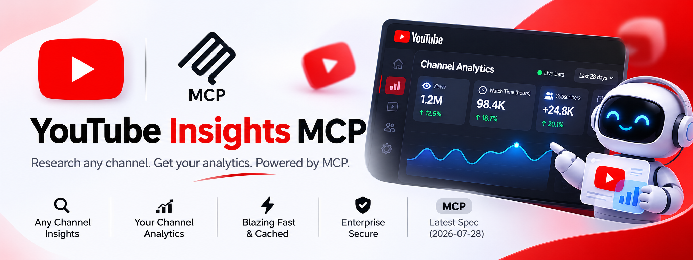

# YouTube Insights MCP

A fast, secure **remote MCP server** that lets Claude (or any MCP client) research any YouTube channel and read **your own channel's analytics**.



- **Any channel:** profile, every upload with tags and stats, comments, a full performance report, channel comparisons, view velocity and niche search.
- **Your channel:** per-video retention, engaged views and subscribers gained, audience by country, age, gender, traffic source and device, retention curves, and raw Analytics queries.
- **Built for speed:** HTTP/2 connection pooling, parallel batched requests (50 videos per call), and a local SQLite cache. A repeated question costs 0 quota and comes back in milliseconds.
- **Latest MCP spec:** Streamable HTTP, running stateless (MCP spec `2026-07-28`). It scales behind any load balancer.
- **Secure:** three auth modes, Google OAuth 2.1 with PKCE, an email allowlist, a constant-time token check, a quota guard, read-only by default, secrets never logged, and errors cleaned before they reach the client.

---

## 1. Google Cloud setup (once, about 5 minutes)

1. Go to [console.cloud.google.com](https://console.cloud.google.com) and create or pick a project.
2. Under **APIs & Services → Library**, enable **YouTube Data API v3** and **YouTube Analytics API**.
3. Under **Credentials → Create credentials → API key**, create a key. Restrict it to *YouTube Data API v3*. This key goes in `YTMCP_YOUTUBE_API_KEY`.
4. For your own analytics, go to **Credentials → Create credentials → OAuth client ID → Web application**.
   - Add these **Authorized redirect URIs**:
     - `http://localhost:8765/oauth2callback` (used by the one-time `login` command)
     - `https://YOUR-PUBLIC-HOST/auth/callback` (only for `google` auth mode)
   - Download the JSON to `secrets/google_client_secret.json`.
5. On the **OAuth consent screen**, while the app is in *Testing*, add your Google account under **Test users**.

## 2. Install and run (needs [uv](https://docs.astral.sh/uv/))

```bash
uv sync
cp .env.example .env                        # then fill in the API key
uv run youtube-insights-mcp gen-token       # paste into YTMCP_BEARER_TOKENS
uv run youtube-insights-mcp doctor          # checks config + API access
uv run youtube-insights-mcp login           # optional: sign in as channel owner for analytics
uv run youtube-insights-mcp serve           # http://127.0.0.1:8080/mcp
```

`login --manual` is for headless servers. You open the link on any computer and paste back the `localhost` address the browser lands on.

## 3. Connect it to Claude

**Claude Code** (token mode):
```bash
claude mcp add --transport http youtube-insights http://127.0.0.1:8080/mcp \
  --header "Authorization: Bearer YOUR_TOKEN"
```

**Claude.ai / Claude Desktop custom connector** (`google` mode, needs a public HTTPS URL):
1. In `.env`, set `YTMCP_AUTH_MODE=google`, `YTMCP_PUBLIC_BASE_URL=https://your-host`, `YTMCP_JWT_SIGNING_KEY=<gen-token output>` and `YTMCP_ALLOWED_EMAILS=you@gmail.com`.
2. Add `https://your-host/auth/callback` to the OAuth client's redirect URIs.
3. In Claude, go to **Settings → Connectors → Add custom connector**, enter `https://your-host/mcp`, then **Connect** and sign in with Google.
   Every user signs in with their own Google account, so "my analytics" means *their* channel.

For quick testing, you can expose a local server with `cloudflared tunnel --url http://localhost:8080` and use the printed https URL.

## 4. Deploy

```bash
docker build -t youtube-insights-mcp .
docker run -d -p 8080:8080 --env-file .env -e YTMCP_HOST=0.0.0.0 \
  -v $PWD/data:/app/data -v $PWD/secrets:/app/secrets:ro youtube-insights-mcp
```
The same image runs on Cloud Run, Fly.io, Railway or Render. Mount `/app/data` on a volume so the cache and sign-in survive restarts. Health check: `GET /healthz`.

---

## Tools

| Tool | Needs | Quota |
|---|---|---|
| `get_channel_overview` | API key | 1-2 |
| `list_channel_videos`: every upload, tags, stats, Short or not | API key | ~1 per 25 videos |
| `get_video_details`: up to 50 videos | API key | 1 |
| `get_video_comments` | API key | 1 |
| `analyze_channel`: Shorts vs long, cadence, best hour/weekday, winning title words, top tags, outliers | API key | ~1 per 25 videos |
| `compare_channels`: 2-6 channels side by side | API key | per channel |
| `get_view_velocity`: views per hour since the last check | API key | ~1 per 25 videos |
| `search_youtube`: videos or channels, with full stats | API key | **100** |
| `get_quota_status` | - | 0 |
| `get_my_channel` | owner sign-in | 1 |
| `get_my_video_performance`: views, engaged views, avg % viewed, watch time, shares, subs | owner sign-in | Analytics quota |
| `get_my_audience`: country, age & gender, traffic source, device, subscribed, content type, day | owner sign-in | Analytics quota |
| `get_my_retention_curve`: 100-point retention and the steepest drop | owner sign-in | Analytics quota |
| `query_my_analytics`: any metrics, dimensions and filters | owner sign-in | Analytics quota |
| `record_studio_metrics` / `get_studio_metrics` | - | 0 |
| `update_video_metadata` (only if `YTMCP_ENABLE_WRITE_TOOLS=true`), preview then confirm | owner sign-in | 50 |

**Not in any Google API:** the Shorts "viewed vs swiped away" %, and impressions/CTR in real time. Copy them from YouTube Studio and save them with `record_studio_metrics` so they can be analyzed next to API data.

**Shorts detection:** a video counts as a Short if it is 3 minutes or less and `youtube.com/shorts/<id>` does not redirect. The result is cached permanently.

## Security notes

- `none` mode refuses to start unless it is bound to `127.0.0.1`.
- In `token` mode, tokens must be 32+ characters and are compared as SHA-256 digests in constant time.
- In `google` mode (OAuth 2.1 via FastMCP's Google proxy), clients register dynamically, PKCE S256 is enforced, and Google tokens are kept server-side, encrypted. The client only gets a signed token from this server. `YTMCP_ALLOWED_EMAILS` locks it to your accounts.
- Read-only scopes are used by default. The write scope is requested only when write tools are enabled, and edits always need a preview first.
- The owner sign-in file is stored with `0600` permissions. Keep `.env`, `secrets/` and `data/` out of git (the provided `.gitignore` does this).
- A local daily quota budget stops a runaway agent from using up your Google quota.

## Development

```bash
uv run pytest            # offline unit tests (HTTP mocked)
uv run ruff check .      # lint
uv run python scripts/smoke_test.py @somechannel   # live end-to-end test against a running server
```

Layout:
```
src/youtube_insights_mcp/
  cli.py            serve | login | doctor | gen-token
  config.py         env settings + validation
  auth.py           token / Google OAuth / allowlist / owner token source
  google_oauth.py   one-time owner login (PKCE) + auto refresh
  youtube_api.py    async Data + Analytics client, retries, quota, cache
  storage.py        SQLite (WAL): cache, video snapshots, Studio metrics, quota
  analysis.py       pure analytics (channel report, velocity)
  server.py         FastMCP app, stateless Streamable HTTP, /healthz
  tools/            public_tools.py, owner_tools.py
```
